

<a href="https://www.sersan.io"></a>

&nbsp;
<a href="#selected-work"><picture><source media="(prefers-color-scheme: dark)" srcset="https://raw.githubusercontent.com/SerSan-Studio/.github/main/profile/assets/btn-work-dark.svg"></picture></a>

SerSan is a founder-led studio for founders, SMEs and growing teams. We build custom software, workflow automation and AI: from one manual workflow to a full production platform, with the honest answer about which one you need.

<picture><source media="(prefers-color-scheme: dark)" srcset="https://raw.githubusercontent.com/SerSan-Studio/.github/main/profile/assets/divider-dark.svg"></picture>

<h2 id="fit"><picture><source media="(prefers-color-scheme: dark)" srcset="https://raw.githubusercontent.com/SerSan-Studio/.github/main/profile/assets/h-fit-dark.svg"></picture></h2>

Each row sets a good fit beside what we turn down. Open a row to read how that part of the work runs.

<picture><source media="(min-width: 768px) and (prefers-color-scheme: dark)" srcset="https://raw.githubusercontent.com/SerSan-Studio/.github/main/profile/assets/fit-1-dark.svg"><source media="(min-width: 768px)" srcset="https://raw.githubusercontent.com/SerSan-Studio/.github/main/profile/assets/fit-1-light.svg"><source media="(prefers-color-scheme: dark)" srcset="https://raw.githubusercontent.com/SerSan-Studio/.github/main/profile/assets/fit-1-narrow-dark.svg"></picture>

 

**Problem.** It starts with one problem worth solving: the manual work, the spreadsheet nobody trusts, the thing that keeps breaking. We map what you actually have, not what the org chart says.

<picture><source media="(min-width: 768px) and (prefers-color-scheme: dark)" srcset="https://raw.githubusercontent.com/SerSan-Studio/.github/main/profile/assets/fit-2-dark.svg"><source media="(min-width: 768px)" srcset="https://raw.githubusercontent.com/SerSan-Studio/.github/main/profile/assets/fit-2-light.svg"><source media="(prefers-color-scheme: dark)" srcset="https://raw.githubusercontent.com/SerSan-Studio/.github/main/profile/assets/fit-2-narrow-dark.svg"></picture>

 

**Scope.** We find what should not be built before code becomes debt. We scope it before anyone writes code: cost, risk, effort, and what it actually saves. Sometimes the honest answer is to build less, or nothing.

<picture><source media="(min-width: 768px) and (prefers-color-scheme: dark)" srcset="https://raw.githubusercontent.com/SerSan-Studio/.github/main/profile/assets/fit-3-dark.svg"><source media="(min-width: 768px)" srcset="https://raw.githubusercontent.com/SerSan-Studio/.github/main/profile/assets/fit-3-light.svg"><source media="(prefers-color-scheme: dark)" srcset="https://raw.githubusercontent.com/SerSan-Studio/.github/main/profile/assets/fit-3-narrow-dark.svg"></picture>

 

**The brief.** Start with the problem, build the smallest useful solution, scale what works. A brief gets a written next step, read by a founder, with a verdict: build, harden or stop. [See what you get](#brief).

<picture><source media="(min-width: 768px) and (prefers-color-scheme: dark)" srcset="https://raw.githubusercontent.com/SerSan-Studio/.github/main/profile/assets/fit-4-dark.svg"><source media="(min-width: 768px)" srcset="https://raw.githubusercontent.com/SerSan-Studio/.github/main/profile/assets/fit-4-light.svg"><source media="(prefers-color-scheme: dark)" srcset="https://raw.githubusercontent.com/SerSan-Studio/.github/main/profile/assets/fit-4-narrow-dark.svg"></picture>

 

**Build.** Then we design and build the system: internal tools, integrations, automations, web and mobile apps, and AI where it earns its place. You work with the builders. Every engagement has a named commercial owner and a named technical owner.

<picture><source media="(min-width: 768px) and (prefers-color-scheme: dark)" srcset="https://raw.githubusercontent.com/SerSan-Studio/.github/main/profile/assets/fit-5-dark.svg"><source media="(min-width: 768px)" srcset="https://raw.githubusercontent.com/SerSan-Studio/.github/main/profile/assets/fit-5-light.svg"><source media="(prefers-color-scheme: dark)" srcset="https://raw.githubusercontent.com/SerSan-Studio/.github/main/profile/assets/fit-5-narrow-dark.svg"></picture>

 

**Proof.** Working software is the only proof. We measure whether it saved the time or the money it was meant to. Monitoring, human review and rollback paths are wired in from day one. We do not claim compliance certifications we don’t hold; we do build systems that pass them.

<picture><source media="(min-width: 768px) and (prefers-color-scheme: dark)" srcset="https://raw.githubusercontent.com/SerSan-Studio/.github/main/profile/assets/fit-6-dark.svg"><source media="(min-width: 768px)" srcset="https://raw.githubusercontent.com/SerSan-Studio/.github/main/profile/assets/fit-6-light.svg"><source media="(prefers-color-scheme: dark)" srcset="https://raw.githubusercontent.com/SerSan-Studio/.github/main/profile/assets/fit-6-narrow-dark.svg"></picture>

 

**Handover.** We hand over something you can run. You own the code and the system, documented and handed over so whoever runs it day to day actually can. We train them, and we stay reachable.

<h2 id="artifacts"><picture><source media="(prefers-color-scheme: dark)" srcset="https://raw.githubusercontent.com/SerSan-Studio/.github/main/profile/assets/h-artifacts-dark.svg">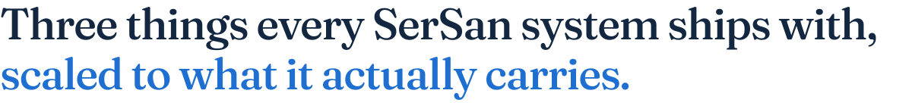</picture></h2>

Not a list of compliance buzzwords. Each one is scaled to the system, and each is an artifact you can ask to see in any scoping call.

<picture></picture>

Versioned test cases, sized to the system: a handful for a workflow tool, a full regression set for a platform. You prove it, instead of hoping.

<picture></picture>

When something goes wrong, the answer is in the record: what came in, what it decided, what it did, who reviewed it. Not Slack archaeology.

<picture></picture>

What the system can reach (data, accounts, actions) is agreed before the first feature. The default answer to an unscoped action is no.

<h2 id="services"><picture><source media="(prefers-color-scheme: dark)" srcset="https://raw.githubusercontent.com/SerSan-Studio/.github/main/profile/assets/h-services-dark.svg">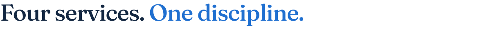</picture></h2>

Start with the problem. Build the smallest useful solution. Scale what works.

- **[Custom Software & Platforms](https://www.sersan.io/services/engineering).** The software your business runs on, built to fit: internal tools and management systems, customer portals and web applications, SaaS products and academy or LMS platforms, integrations across the tools you use.
- **[Workflow Automation](https://www.sersan.io/services/automation).** Start with the process that eats the most time: repetitive back-office work handed off, documents read, checked and filed, leads, orders and CRM data kept in sync, failures surfaced and retried.
- **[AI Features & Reliability](https://www.sersan.io/services/mlops).** AI that holds up once real customers use it: assistants and copilots on your own content, agents that act within the limits you set, tested against real cases before release, monitored live for cost, quality and accuracy.
- **[Technical Audits & Architecture](https://www.sersan.io/services/architecture).** Find what should not be built, before code becomes debt: a systems and process audit, a build, buy or don't-build call, where AI would actually pay off, a target architecture that is sequenced and costed.

<h2 id="selected-work"><picture><source media="(prefers-color-scheme: dark)" srcset="https://raw.githubusercontent.com/SerSan-Studio/.github/main/profile/assets/h-work-dark.svg"></picture></h2>

Four projects the site labels SerSan delivery. The [full archive](https://www.sersan.io/case-studies) also lists prior senior delivery, labelled as such.

- **[SphereNode](https://www.sersan.io/case-studies/spherenode)** · FinTech · Trading Education · RAG Mentor · Community · CRM
- **[Quantex.live](https://www.sersan.io/case-studies/quantex)** · FinTech · Quant · LLM Agents · Real-Time Data
- **[Domus Tua](https://www.sersan.io/case-studies/domus-tua)** · Real Estate · Brand Site · Motion Design · Lead Generation
- **[Terra Noa](https://www.sersan.io/case-studies/terra-noa)** · Agritech · Renewables · IoT · Predictive Maintenance · SCADA

Most of what we build belongs to clients and stays private.

<h2 id="brief"><picture><source media="(prefers-color-scheme: dark)" srcset="https://raw.githubusercontent.com/SerSan-Studio/.github/main/profile/assets/h-brief-dark.svg"></picture></h2>

One workflow, one product idea, one system that keeps breaking, or something your team still does manually. Tell us what's happening. We'll tell you what we'd do next.

<picture><source media="(min-width: 768px)" srcset="https://raw.githubusercontent.com/SerSan-Studio/.github/main/profile/assets/brief.svg"></picture>

&nbsp;
<a href="mailto:alex.s@sersan.dev?subject=Project%20brief"><picture><source media="(prefers-color-scheme: dark)" srcset="https://raw.githubusercontent.com/SerSan-Studio/.github/main/profile/assets/btn-email-dark.svg"></picture></a>
&nbsp;
<a href="https://www.sersan.io"><picture><source media="(prefers-color-scheme: dark)" srcset="https://raw.githubusercontent.com/SerSan-Studio/.github/main/profile/assets/btn-site-dark.svg"></picture></a>

Reply within one business day.

<picture><source media="(prefers-color-scheme: dark)" srcset="https://raw.githubusercontent.com/SerSan-Studio/.github/main/profile/assets/divider-dark.svg"></picture>

<picture>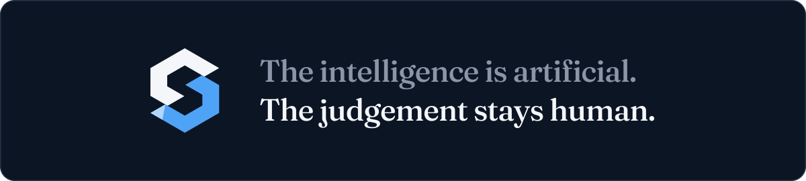</picture>

© 2026 Sersan Limited · 128 City Road, London EC1V 2NX · Co. No. 16878386 · <a href="https://www.linkedin.com/company/sersan-limited">LinkedIn</a>

